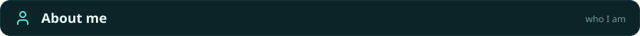
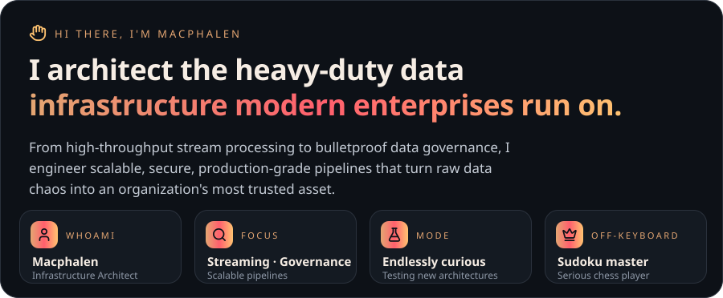

<h2>
  
  Hello there!
</h2>

 

 

 

 

  &nbsp;
  &nbsp;
  &nbsp;
  &nbsp;
  &nbsp;
  &nbsp;
  &nbsp;
  &nbsp;
  &nbsp;
  
   
  &nbsp;
  &nbsp;
  &nbsp;
  &nbsp;
  &nbsp;
  &nbsp;
  &nbsp;
  &nbsp;
   
  &nbsp;
  
  &nbsp;
  &nbsp;
  &nbsp;
  &nbsp;
  &nbsp;
  &nbsp;
  &nbsp;
  
   
  &nbsp;
  &nbsp;
  &nbsp;
  &nbsp;
  &nbsp;
  &nbsp;
  &nbsp;
  &nbsp;
  

 

 

<a href="https://github.com/mac0duor0fficial-1028">
  <picture>
    <source media="(prefers-color-scheme: dark)" srcset="https://github-readme-stats.shion.dev/api?username=mac0duor0fficial-1028&show_icons=true&hide_border=true&include_all_commits=true&count_private=false&bg_color=00000000&title_color=ffffff&text_color=a1a1aa&icon_color=2dd4bf&ring_color=2dd4bf">
    <source media="(prefers-color-scheme: light)" srcset="https://github-readme-stats.shion.dev/api?username=mac0duor0fficial-1028&show_icons=true&hide_border=true&include_all_commits=true&count_private=false&bg_color=00000000&title_color=0a0a0a&text_color=52525b&icon_color=0d9488&ring_color=0d9488">
    
  </picture>
</a>
<a href="https://github.com/mac0duor0fficial-1028">
  <picture>
    <source media="(prefers-color-scheme: dark)" srcset="https://github-readme-stats.shion.dev/api/top-langs/?username=mac0duor0fficial-1028&layout=compact&langs_count=6&hide_border=true&bg_color=00000000&title_color=ffffff&text_color=a1a1aa">
    <source media="(prefers-color-scheme: light)" srcset="https://github-readme-stats.shion.dev/api/top-langs/?username=mac0duor0fficial-1028&layout=compact&langs_count=6&hide_border=true&bg_color=00000000&title_color=0a0a0a&text_color=52525b">
    
  </picture>
</a>

 

<a href="https://github.com/mac0duor0fficial-1028">
  <picture>
    <source media="(prefers-color-scheme: dark)" srcset="https://streak-stats.demolab.com/?user=mac0duor0fficial-1028&hide_border=true&background=00000000&stroke=3f3f46&ring=2dd4bf&fire=2dd4bf&currStreakNum=ffffff&sideNums=ffffff&currStreakLabel=2dd4bf&sideLabels=a1a1aa&dates=71717a">
    <source media="(prefers-color-scheme: light)" srcset="https://streak-stats.demolab.com/?user=mac0duor0fficial-1028&hide_border=true&background=00000000&stroke=d4d4d8&ring=0d9488&fire=0d9488&currStreakNum=0a0a0a&sideNums=0a0a0a&currStreakLabel=0d9488&sideLabels=52525b&dates=71717a">
    
  </picture>
</a>

 

 

<!-- Replace YOUR-LINKEDIN-USERNAME and youremail@example.com with your real details -->
&nbsp;&nbsp;
&nbsp;&nbsp;

 

