<!-- ═══════════════════════  HEADER  ═══════════════════════ -->


<div align="center">

<a href="https://github.com/mac0duor0fficial-1028">
  
</a>

<br/>


</div>

<br/>

<!-- ═══════════════════════  ABOUT  ═══════════════════════ -->
<div align="center">

## ⟦ &nbsp; ABOUT ME &nbsp; ⟧


### I architect the heavy-duty data infrastructure that modern enterprises run on.

From high-throughput `stream processing` to bulletproof `data governance`, I engineer scalable, secure, production-grade pipelines that turn raw data chaos into an organization's most trusted asset.

</div>

<br/>

```text
╔══════════════════════════════════════════════════════════════════════╗
║  👤  whoami        →  Macphalen · Data Infrastructure Architect      ║
║  🔍  focus         →  Streaming · Governance · Scalable Pipelines    ║
║  🧪  mode          →  Endlessly curious, always testing new tools    ║
║  ♟️   off-keyboard  →  Sudoku master · Serious chess player          ║
║  🎯  philosophy    →  Solving puzzles is what I do, on and off board ║
╚══════════════════════════════════════════════════════════════════════╝
```

<br/>

<!-- ═══════════════════════  PIPELINE VIEW  ═══════════════════════ -->
<div align="center">

## ⟦ &nbsp; HOW I THINK ABOUT DATA &nbsp; ⟧

```mermaid
%%{init: {'theme':'dark','themeVariables':{'primaryColor':'#1b1f27','primaryTextColor':'#ffffff','primaryBorderColor':'#ff5f6d','lineColor':'#ffc371','secondaryColor':'#262b36','tertiaryColor':'#0d1117','fontFamily':'monospace'}}}%%
flowchart LR
    A[("🌪️ Raw Data<br/>Chaos")] --> B["📡 Ingest<br/>Kafka · APIs"]
    B --> C["⚙️ Process<br/>Stream & Batch"]
    C --> D["🛡️ Govern<br/>Quality · Lineage · Security"]
    D --> E[("🏛️ Store<br/>SQL · NoSQL")]
    E --> F["📊 Serve<br/>FastAPI · Grafana"]
    F --> G(("✅ Trusted<br/>Asset"))

    style A fill:#3a1f24,stroke:#ff5f6d,stroke-width:2px
    style G fill:#2d2a1a,stroke:#ffc371,stroke-width:3px
    style D fill:#2a2230,stroke:#e4a672,stroke-width:2px
```

</div>



<br/>

<div align="center">

| 🧱 **Reliable** | 📈 **Scalable** | 🔐 **Governed** | 👁️ **Observable** |
|:---:|:---:|:---:|:---:|
| Pipelines that fail loudly and recover gracefully | Designed for 10× growth, not today's volume | Quality, lineage & access built in, not bolted on | If it isn't measured, it isn't production |

</div>

<br/>

<!-- ═══════════════════════  TECH STACK  ═══════════════════════ -->
<div align="center">

## ⟦ &nbsp; TECH ARSENAL &nbsp; ⟧

**⚙️ Languages & Databases**


**📡 Data, Streaming & Observability**


**☁️ Cloud & DevOps**


**🧰 Daily Drivers**


</div>

<br/>

<details>
<summary><b>🔎 &nbsp;Expand: how I use each layer</b></summary>

<br/>

| Layer | Tools | What I use them for |
|:---|:---|:---|
| **Languages** | Python · Bash · R | Pipeline logic, automation, statistical analysis |
| **Relational** | PostgreSQL · MySQL | Transactional stores, modelling, warehousing |
| **NoSQL** | MongoDB · Cassandra | Flexible documents, wide-column and high-write workloads |
| **Streaming** | Apache Kafka | Real-time event ingestion and processing |
| **Serving** | FastAPI | Fast, typed data APIs |
| **Observability** | Grafana | Dashboards, pipeline health, alerting |
| **Cloud** | AWS · Azure · GCP | Multi-cloud infrastructure |
| **Delivery** | Docker · Git | Reproducible builds and version control |

</details>

<br/>

<!-- ═══════════════════════  STATS  ═══════════════════════ -->
<div align="center">

## ⟦ &nbsp; BY THE NUMBERS &nbsp; ⟧

<a href="https://github.com/mac0duor0fficial-1028">
  
</a>
<a href="https://github.com/mac0duor0fficial-1028">
  
</a>

<br/><br/>

<a href="https://github.com/mac0duor0fficial-1028">
  
</a>

<br/><br/>


</div>

<br/>

<!-- ═══════════════════════  TROPHIES  ═══════════════════════ -->
<div align="center">

## ⟦ &nbsp; TROPHY CABINET &nbsp; ⟧

<a href="https://github.com/ryo-ma/github-profile-trophy">
  
</a>

</div>

<br/>

<!-- ═══════════════════════  SNAKE  ═══════════════════════ -->
<div align="center">

## ⟦ &nbsp; 🐍 THE SNAKE DEVOURS MY CONTRIBUTIONS &nbsp; ⟧

<picture>
  <source media="(prefers-color-scheme: dark)" srcset="https://raw.githubusercontent.com/mac0duor0fficial-1028/mac0duor0fficial-1028/output/github-contribution-grid-snake-dark.svg">
  <source media="(prefers-color-scheme: light)" srcset="https://raw.githubusercontent.com/mac0duor0fficial-1028/mac0duor0fficial-1028/output/github-contribution-grid-snake.svg">
  
</picture>

</div>

<br/>

<!-- ═══════════════════════  OFF THE KEYBOARD  ═══════════════════════ -->
<div align="center">

## ⟦ &nbsp; OFF THE KEYBOARD &nbsp; ⟧

</div>

```text
   ♜ ♞ ♝ ♛ ♚ ♝ ♞ ♜          ┌───┬───┬───┐
   ♟ ♟ ♟ ♟ ♟ ♟ ♟ ♟          │ 5 │ 3 │ · │
   · · · · · · · ·          ├───┼───┼───┤
   · · · · · · · ·          │ 6 │ · │ · │
   · · · · · · · ·          ├───┼───┼───┤
   · · · · · · · ·          │ · │ 9 │ 8 │
   ♙ ♙ ♙ ♙ ♙ ♙ ♙ ♙          └───┴───┴───┘
   ♖ ♘ ♗ ♕ ♔ ♗ ♘ ♖
     Chess: strategy         Sudoku: logic
        under pressure         constraint solving
```

> *Chess trains pattern recognition under pressure. Sudoku trains constraint satisfaction. Data engineering needs both.*

<br/>

<!-- ═══════════════════════  CURRENTLY  ═══════════════════════ -->
<div align="center">

## ⟦ &nbsp; CURRENTLY &nbsp; ⟧

| 🔭 Exploring | 🛠️ Sharpening | 🎯 Aiming For |
|:---:|:---:|:---:|
| New tools & advanced architectures in the data space | Stream processing & governance at scale | Production-grade pipelines people can trust |

</div>

<br/>

<!-- ═══════════════════════  QUOTE  ═══════════════════════ -->
<div align="center">


<br/><br/>


</div>

<br/>

<!-- ═══════════════════════  CONNECT  ═══════════════════════ -->
<div align="center">

## ⟦ &nbsp; LET'S CONNECT &nbsp; ⟧

<!-- 👉 Replace the two placeholders below with your real LinkedIn URL and email -->
<a href="https://linkedin.com/in/YOUR-LINKEDIN-USERNAME"></a>
<a href="mailto:youremail@example.com"></a>
<a href="https://github.com/mac0duor0fficial-1028"></a>

<br/><br/>

*Got a messy data problem? Let's talk.*

</div>


