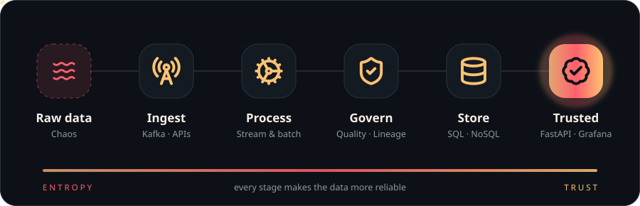
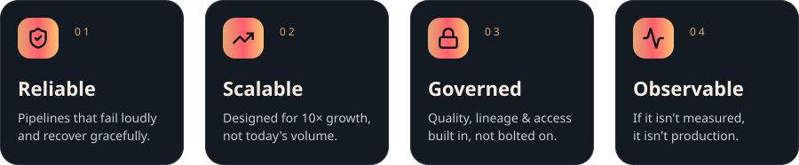
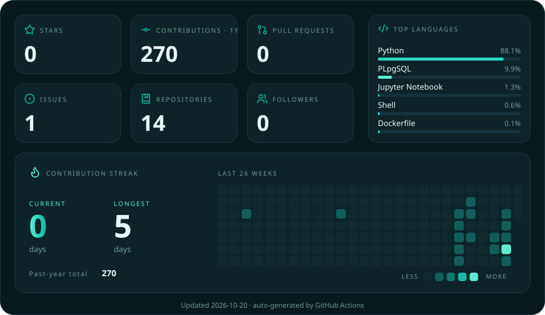
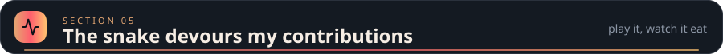
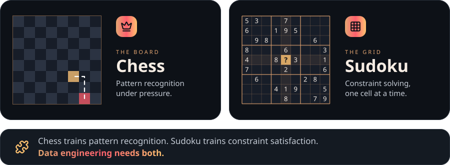
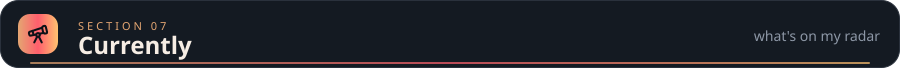
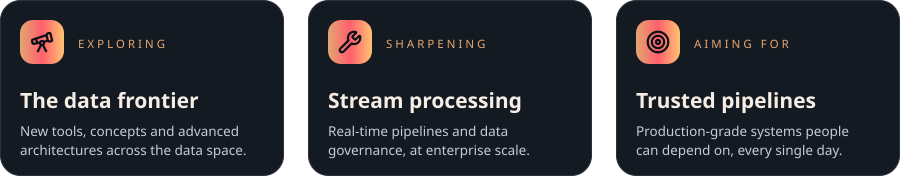

 

 

 

 

 

 

 

 

 

 

 

<picture>
  <source media="(prefers-color-scheme: dark)" srcset="https://raw.githubusercontent.com/mac0duor0fficial-1028/mac0duor0fficial-1028/output/github-contribution-grid-snake-dark.svg">
  <source media="(prefers-color-scheme: light)" srcset="https://raw.githubusercontent.com/mac0duor0fficial-1028/mac0duor0fficial-1028/output/github-contribution-grid-snake.svg">
  
</picture>

 

 

 

 

 

 

<!-- 👉 Replace YOUR-LINKEDIN-USERNAME and youremail@example.com with your real details -->
&nbsp;&nbsp;
&nbsp;&nbsp;

 

